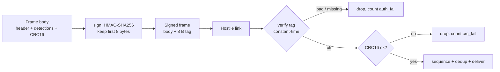
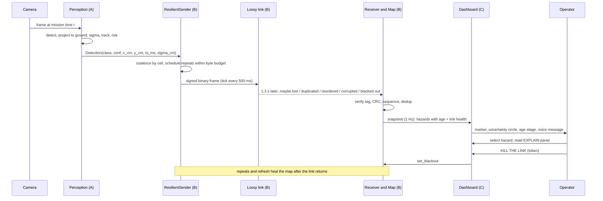

# 🌙 Project C.R.A.T.E.R.
### Constrained Reconnaissance, Autonomy & Telemetry in Extreme Regions
**ATEC'26 – "A Mission Beyond Limits"** · ESPRIT IEEE Student Branch · 100 % software-emulated, 100 % offline

> A lunar scout rover is inside a permanently shadowed crater. There is **no GPS, no cellular network, no cloud**, and the radio link is slow, lossy and sometimes completely dark.
> **C.R.A.T.E.R. makes the rover think for itself**: it sees hazards on board, turns pixels into map coordinates, squeezes the result into a few bytes, pushes it through a hostile link, and shows Mission Control **what is known, how old it is, how sure we are, and why.**

---

## Table of contents
1. [At a glance](#1-at-a-glance)
2. [The problem and our answer](#2-the-problem-and-our-answer)
3. [How we address the judging rubric](#3-how-we-address-the-judging-rubric)
4. [System architecture](#4-system-architecture)
5. [The pipeline, stage by stage](#5-the-pipeline-stage-by-stage)
   - 5.1 [Perceive – on-board detection](#51-perceive--on-board-detection)
   - 5.2 [Localize – pixels to map coordinates](#52-localize--pixels-to-map-coordinates)
   - 5.3 [Transmit – compact, resilient telemetry](#53-transmit--compact-resilient-telemetry)
   - 5.4 [Visualize – Mission Control](#54-visualize--mission-control)
6. [Security and authentication layer](#6-security-and-authentication-layer)
7. [Explainable AI (XAI)](#7-explainable-ai-xai)
8. [Multimodal operator interface](#8-multimodal-operator-interface)
9. [Workflow](#9-workflow)
10. [Technology stack](#10-technology-stack)
11. [Getting started](#11-getting-started)
12. [Tests and reproducibility](#12-tests-and-reproducibility)
13. [Space flight-software principles](#13-space-flight-software-principles)
14. [Honest limitations and roadmap](#14-honest-limitations-and-roadmap)
15. [Repository layout](#15-repository-layout)
16. [Credits](#16-credits)
17. [Maintainers' checklist (delete before submission)](#17-maintainers-checklist-delete-before-submission)

---

## 1. At a glance

| What | Value | Where it comes from |
|---|---|---|
| Data flow | **Perception → Telemetry → Dashboard** (the fixed flow required by the spec) | `bridge.py` |
| Hazard detector | YOLOv8n fine-tuned on lunar renders, **3.13 M parameters, 8.6 GFLOPs** | training log, notebook cell 2.4 |
| Detector accuracy (validation) | **mAP50 0.667**, mAP50-95 0.390, precision 0.728, recall 0.627 (243 images, 705 boxes) | notebook cell 2.4 |
| Learned vs. classical baseline | recall@IoU 0.3: **0.76** (106/139) vs **0.04** (6/139) | notebook cell 2.4 |
| Edge speed (CPU only) | **≈ 13 FPS**, 76.7 ms average, 79.6 ms p95 | `perception_metrics_finetuned.json` |
| Radio frame | **17 bytes** for one detection, **+7 bytes** per extra detection, **234 bytes** max (32 detections) | asserted in `final_check.py` |
| Versus a JSON baseline | binary is **≥ 8× smaller** (asserted threshold) | `final_check.py` |
| Authentication cost | **+8 bytes** per frame (HMAC-SHA256, truncated) | `security.py`, `final_check.py` |
| Link emulation | loss (bursty), latency, jitter, duplicates, reordering, bit corruption, **blackouts** – all seeded and reproducible | `link.py`, `final_check.py` |
| Default one-way latency | **1 300 ms** (about the Earth–Moon light time) | `bridge.py` |
| Dashboard | React 18 map with aging, uncertainty circles, link panel, replay, wall display, voice | `dashboard/` |
| Automated checks | **30** end-to-end telemetry checks + **25** dashboard unit tests (+ the perception test-suite) | `final_check.py`, `dashboard/tests/` |
| Cloud dependency | **None** (no cloud APIs, offline voice, local model) | whole repo |

---

## 2. The problem and our answer

Inside a permanently shadowed lunar crater, standard Earth infrastructure does not exist, and the regolith absorbs high-frequency radio. A rover that finds a hazard or an ice deposit during a blackout **cannot stream video home**. It needs resilient *edge AI and software* that can:

| Required capability (spec) | Our answer |
|---|---|
| Process raw visual data locally | Fine-tuned **YOLOv8n** on CPU, with an automatic **classical-CV fallback** |
| Turn insights into spatial coordinates | **Pinhole camera + flat-ground ray intersection**, with first-order **uncertainty propagation** |
| Compress telemetry into minimal payloads | **Custom binary frames** (7 bytes per detection) with CRC-16 |
| Relay through lossy networks | **Redundancy without ACKs**: spaced repeats, background refresh, coalescing, a byte budget |
| Show actionable data to Mission Control | **Dashboard** with data age, uncertainty circles, link health and explanations |

Beyond the minimum, we added three things that matter for a *trustworthy* mission: an **authentication layer**, an **explainability layer** (the operator can always ask *why*), and a **multimodal operator interface** (visual + textual + spoken, all offline).

---

## 3. How we address the judging rubric

| Rubric category (15 % each) | What we built | Evidence in the repo |
|---|---|---|
| **Edge Perception Efficiency** | YOLOv8n (3.13 M params) on CPU at ≈ 13 FPS; a millisecond-class classical fallback; hazard tracking so a rock is reported once, not every frame | `perception_metrics_finetuned.json`, notebook cells 2.4 / 2.6 |
| **Spatial & Kinematic Math** | Pixel → ground derivation, sign-checked world frame (+x east, +y north), σ propagation from five error sources | [§5.2](#52-localize--pixels-to-map-coordinates), `perception/geometry.py`, hand-computed unit tests, synthetic ground-truth evaluation |
| **Telemetry & Protocol Efficiency** | 17 B / +7 B per detection / 234 B frames; ≥ 8× smaller than JSON; payload survival measured against a naive sender at 0–50 % loss and through a 10 s blackout | [§5.3](#53-transmit--compact-resilient-telemetry), `final_check.py` groups 1–4 |
| **Mission Control Dashboard** | Real-time ingestion at 1 Hz, FRESH / AGING / STALE / EXPIRED stages, growing uncertainty circles, link state machine, 5-minute replay, wall display | [§5.4](#54-visualize--mission-control), `dashboard/tests/` |
| **Systems Integration & Space Compliance** | One command brings up rover → lossy UDP → receiver → WebSocket → browser; bounded memory everywhere, deterministic seeds, integrity checks, graceful degradation | [§13](#13-space-flight-software-principles), `bridge.py`, `final_check.py` |
| **Finals – Pitch & Q&A (25 %)** | A scripted 6-step live demo built into the dashboard, and a 7-minute pitch map | [§9.3](#93-live-demo-script), [§9.4](#94-seven-minute-pitch-map) |

---

## 4. System architecture

```mermaid
flowchart LR
    subgraph ROVER["ROVER (emulated)"]
        CAM["Camera frames"] --> PER["PERCEIVE<br/>YOLOv8n + classical fallback"]
        PER --> LOC["LOCALIZE<br/>pixel to ground, sigma, tracking, risk"]
        LOC --> RS["ResilientSender<br/>repeat / refresh / coalesce / budget"]
        RS --> SND["Sender<br/>binary frame + CRC16 + HMAC tag"]
    end
    SND --> LINK["LOSSY LINK EMULATOR<br/>loss, latency 1.3 s, jitter, dup,<br/>reorder, corruption, blackout"]
    LINK -->|"UDP datagrams"| RX
    subgraph GROUND["MISSION CONTROL (ground)"]
        RX["Receiver<br/>verify tag, CRC, sequence, dedup"] --> MAP["MissionMap<br/>latest observation wins"]
        MAP --> BR["Bridge<br/>WebSocket snapshots, 1 Hz"]
        BR --> UI["DASHBOARD<br/>map, aging, uncertainty, link panel,<br/>XAI panel, voice"]
    end
    UI -.->|"set_blackout + token"| BR
```



**Ownership.** Three people, three contracts:

| Role | Owns | Main folders |
|---|---|---|
| **Person A** | Perceive + Localize (detector, camera math, uncertainty, tracking, risk) | `perception/`, training notebook |
| **Person B** | Transmit (codec, lossy link, resilience, security, UDP, bridge) | `telemetry/` |
| **Person C** | Visualize (dashboard, XAI panel, voice, wall display, simulation) | `dashboard/` |

**The agreed contract A → B** (one record per detection):

```
Detection(class_id:int, conf:int 0..7, x_cm:int, y_cm:int, ts_ms:int, sigma_cm:float)
```

* `x_cm`, `y_cm` – ground position **relative to the landing site**, **+x east, +y north**, centimetres, `int16` range (±327 m)
* `ts_ms` – mission time of the frame the detection came from
* `sigma_cm` – 1-σ position error, clamped to 5 … 5000 cm, **grows with distance** (explodes near the horizon)

The dashboard consumes a **snapshot** (≈ 1 per second) over `ws://localhost:8765`: `{type, t_ms, hazards[], link{}}` (full schema in [`dashboard/README.md`](dashboard/README.md)).

---

## 5. The pipeline, stage by stage

### 5.1 Perceive – on-board detection

**Goal:** find hazards from visual frames **locally**, fast, with no external API.

**Hybrid detector (fallback by design)**

| Layer | Role | Why |
|---|---|---|
| **YOLOv8n fine-tuned** (`best.pt`) | Detects **rocks** (class 0) | Small enough for an edge CPU; pretrained on COCO, adapted to lunar renders |
| **Classical CV** (top-hat contrast + contour rules) | Pit / bright patch candidates (classes 1, 2) and **automatic fallback for rocks** | No training, no weights file, millisecond-class; keeps the rover seeing if the model fails |

If the model is missing, corrupt, or raises an exception, the hybrid detector falls back to the classical rocks, flags itself as **degraded**, and **stops retrying a broken model every frame** (it pauses after 3 consecutive failures). The frame loop never crashes.

**Training data and method**

| Item | Value |
|---|---|
| Dataset | *Artificial Lunar Rocky Landscape Dataset* (photorealistic renders with rock ground truth) |
| Curated subset | 1 953 images (a filtered subset of the original, verified to be 100 % contained in it) |
| Labels | `bounding_boxes.csv` exists for **large rocks only** → the model is fine-tuned for `rock` |
| Cleaning | 18 867 raw rows → drop NaN / duplicates / non-curated / boxes < 4 px / giant boxes → **3 847 clean boxes in 1 269 images** |
| Split | 1 026 train / 243 val, **block split by frame number** (blocks of 20) so near-duplicate frames never leak between train and validation |
| Training | YOLOv8n, COCO weights, backbone partly frozen (`freeze=10`), 640 px, up to 20 epochs on a T4 GPU |
| Validation | mAP50 **0.667**, mAP50-95 0.390, P 0.728, R 0.627 |
| Baseline | A classical adaptive-threshold detector reached **recall 0.04** on the same images; the learned model reaches **0.76** |

**Edge efficiency (CPU only, the rover has no GPU):** ≈ **13 FPS**, 76.7 ms average, 79.6 ms p95, for the YOLO + rules pipeline.

> **Honest note.** Pit and bright-patch classes have **no ground truth** in the dataset, so they remain rule-based and unvalidated. The classical fallback in `perception/classical.py` was validated only on **synthetic** frames with known positions; run it on real renders before trusting its recall.

### 5.2 Localize – pixels to map coordinates

**Goal:** convert a 2-D detection into a position on the ground, with an error bar.

**Model.** A pinhole camera at height `H` above **flat ground**, pitched **down** by `θ`, no roll, no lens distortion. The ground contact point of a hazard is the **bottom-centre of its bounding box**.

```
pixel (u, v)  ->  normalised ray      dx = (u - cx) / fx ,   dy = (v - cy) / fy
rover frame   :  R = right, F = forward, U = up
optical axis  :  a = cos(θ) F - sin(θ) U
image "down"  :  d = -sin(θ) F - cos(θ) U
ray           :  dx R + dy d + a              ->  up-component = -(dy cos θ + sin θ)

intersect the ground plane (z = -H):
    t       = H / (dy cos θ + sin θ)          (t = depth along the optical axis)
    right   = t · dx
    forward = t · (cos θ - dy sin θ)          (centre column: forward = H / tan(θ + atan dy))

if dy cos θ + sin θ ≤ 0  ->  the ray never reaches the ground (above the horizon)  ->  rejected
```

**Hand-checked cases** (used as unit tests, camera 100 cm high, 10° down, 70° HFOV): the image-centre pixel lands at `H / tan 10° = 567.13 cm`; a pixel whose ray is 20° below horizontal lands at `H / tan 20° = 274.75 cm`; projecting known ground points to pixels and back recovers them to 10⁻⁶ cm.

**Frames and conventions** (the source of expensive bugs, so we fixed them early)

| Frame | Axes | Unit |
|---|---|---|
| **World** (what Mission Control sees) | origin = landing site, **+x east, +y north** | cm |
| **Rover** (what the camera sees) | **x = right, y = forward** | cm |
| Heading | degrees **clockwise from north** (0 = facing north, 90 = facing east) | ° |

```
world.x = pose.x + right·cos(h) + forward·sin(h)
world.y = pose.y - right·sin(h) + forward·cos(h)
```

There is no real odometry in the emulation, so the rover pose comes from a replaceable provider (static, or constant-velocity). Replace it with real odometry without touching the rest.

**Uncertainty (`sigma_cm`) – why it grows with distance.** Each input error is perturbed by its 1-σ value and the resulting **ground displacement** is measured; independent sources add in quadrature:

| Source | Default 1-σ | Effect |
|---|---|---|
| Pixel error (u) | 2 px | sideways error, grows with range |
| Pixel error (v) | 2 px | range error, grows ≈ with range² |
| Camera pitch error | 0.5° | range error, grows ≈ with range² |
| Camera height error | 2 cm | range error ∝ range |
| Pose / odometry floor | 10 cm | constant |
| Hazard-radius estimate | 30 % of radius | only when contact-to-centre correction is on |

`sigma_cm = sqrt(Σ source²)`, clamped to **5 … 5000 cm**. Near the horizon the ray is almost parallel to the ground, the displacement explodes, and the value saturates at 5000 cm. Unit tests check the pixel and pitch terms against **analytic derivatives** (`dF/dv = H / (sin²α · (1 + dy²) · fy)` and `dF/dθ = -H / sin²α`).

**Tracking: the same rock keeps the same coordinate and the same ID.** Hazards are static, so each observation is converted to the world frame, matched to existing tracks (**Hungarian assignment**, same class, a distance gate that grows with σ) and fused by **inverse-variance weighting**: close, precise views dominate far, noisy ones. Because pitch and height errors are *systematic* (they do not average out), the fused σ is floored at 0.6 × the best single-view σ. Memory is bounded (maximum 200 tracks).

**Path-risk assessment (heuristic).** For each confirmed hazard, a transparent score combines corridor overlap, proximity, size and uncertainty into **LOW / MEDIUM / HIGH** ([§7.3](#73-risk-score-a-transparent-formula)). It is explicitly *not* a validated safety prediction.

**Measured on a synthetic feed with known hazard positions** (flat ground, perfect pose, 4 random worlds of 10 rocks, 40 s drive; `perception/synthetic.py`):

| Metric | Result |
|---|---|
| Median position error | **16.6 – 21.1 cm** (p95 40.7 – 58.8 cm) |
| Precision (reported hazards that are real) | **100 %** |
| Track IDs per real rock | **exactly 1** (no ID switches) |
| Errors inside 1-σ / 2-σ | 93 – 96 % / 97 – 99 % (ideal 63 % / 98 %: our σ is deliberately conservative because the synthetic world has no pitch or height error) |

> **Caveat.** These numbers prove the *math and the tracker*, not real-terrain accuracy. Real ground is not flat; real pitch is not perfectly known. See [§14](#14-honest-limitations-and-roadmap).

### 5.3 Transmit – compact, resilient telemetry

**Goal:** deliver the map to Earth through a link that drops, delays, duplicates, reorders and corrupts packets.

#### a) Binary frame (the "ultra-compact format")

| Frame | Size |
|---|---|
| 1 detection | **17 bytes** |
| each extra detection | **+7 bytes** |
| 32 detections (max per frame; larger batches are split) | **234 bytes** |
| same frames **with** authentication tag | 25 B and 242 B max |

Structure (derived from the asserted sizes 17 / +7 / 234, i.e. 8 + 7·n + 2): a **header** (protocol version, flags `CRITICAL` / `RETRANSMIT`, 16-bit sequence number, base time), **7 bytes per detection** (class and confidence, `x` and `y` as `int16`, a 1-byte time offset with 100 ms resolution covering 25.5 s, and a 1-byte quantised σ with ≤ 3 % error over 5 … 5000 cm), and a **CRC-16**. Out-of-range values clamp safely instead of wrapping (`x = 99999` → `32767`).

Verified properties: a **single flipped bit anywhere** in a frame is rejected; empty, truncated, garbage and wrong-version data return `None`; timestamps stay within 100 ms; **the binary encoding is ≥ 8× smaller than the JSON baseline**.

#### b) Lossy-link emulator (`LossyLink`)

A deterministic, seeded model of a bad radio link:

| Effect | Notes |
|---|---|
| Packet loss | uniform or **bursty** (the average hits the requested rate ± 3 points at 10 / 30 / 50 %) |
| Latency and jitter | defaults 1 300 ms ± 100 ms |
| Duplicates, reordering | configurable rates |
| Bit corruption | every corrupted packet is caught by the CRC |
| **Blackouts** | scheduled windows (e.g. 20 → 30 s) or toggled live from the dashboard |

Same seed → **byte-identical run**, so the jury can reproduce every figure.

#### c) Resilience without ACKs (`ResilientSender`)

An ACK needs a return channel that a blacked-out crater may not have. The rover instead **sends smartly, blind**:

| Mechanism | What it does |
|---|---|
| **Priority tiers** | New hazards go out first; spaced repeats second; background refresh last |
| **Per-class repeats** | boulder × 2, crater × 3, ice × 3, beacon × 1 (high-value classes get more chances) |
| **Spaced repeats** | 1 500 ms apart, so one burst of loss cannot kill all copies |
| **Background refresh** | every 10 s, so the ground map self-heals after a blackout |
| **Coalescing** | one entry per ~1 m map cell, latest observation wins |
| **Byte budget** | repeats and refresh share a token bucket (40 B/s); only *new* hazards may overdraw it |
| **Flags** | `CRITICAL` for 3-repeat classes, `RETRANSMIT` when every entry was already sent |
| **Bounded memory** | evicts beacons first, then the oldest; cap on entries |

Asserted by `final_check.py`: the resilient sender's map coverage is **never below a naive sender's at any loss level**, **above 90 % at 30 % loss**, and **more than 15 points better at 50 % loss**; the average rate stays **under 150 B/s**; every frame stays ≤ 234 B; and **hazards seen *during* a blackout are delivered after the link returns**.

#### d) Receiver (`Receiver`)

Order of operations for every datagram: **authenticate → CRC → sequence → de-duplicate → deliver.**

* 16-bit sequence numbers are **extended** so wrap-around (65530 → 13) counts correctly
* A bounded window (1 024 frames) de-duplicates repeats; reordered frames are accepted and counted
* **Link health** feeds the dashboard: expected / received / lost / loss %, CRC failures, **authentication failures**, duplicates, reordered, bytes received, time since last contact
* Random garbage (2 000 datagrams) never crashes it

#### e) Ground map (`MissionMap`)

Latest observation wins, **keyed by class and ~1 m cell**; a stale repeat can never overwrite newer data; memory is capped.

### 5.4 Visualize – Mission Control

An **offline-first React dashboard** (no CDN, no cloud) that answers three questions at a glance: **what is out there, how old is the information, and how sure are we?**

| Feature | Behaviour |
|---|---|
| **Live map** | Zoom, pan, follow rover, class filters, hazard selection, rover path, landing-site origin, reference markers (`K`) |
| **Data aging** | `FRESH < 5 s` → `AGING < 30 s` → `STALE ≤ 120 s` → `EXPIRED > 120 s` → removed after 600 s. Fading opacity, gray dashed outline when stale |
| **Uncertainty circles** | radius = `min(300 cm, sigma_cm + 3 cm/s × age)` – the circle **keeps growing while the data ages**. If `sigma_cm` is missing: `10 cm + 0.05 × distance × (1 − conf/7)`, labelled *estimated* |
| **Link state machine** | `NO CONTACT` → `AOS` (linked) → `DEGRADED` (> 3 s without a packet) → `LOS` (> 10 s) / `BLACKOUT` / `SERVER DISCONNECTED`; last-packet indicator green < 2 s, amber 2 – 10 s, red > 10 s |
| **Link quality gauge** | `100 − windowed_loss% − 2 × last_packet_age_s`, clamped 0 – 100 |
| **Kill / restore link** | Sends `set_blackout` (with token); the button only flips when a snapshot **confirms** it |
| **Replay** | Pause live, scrub the last 5 minutes, resume |
| **Wall display** | A 1920 × 1080 projection HUD (`W`): gauges, class and age stages, schematic with range rings, map, charts |
| **Bandwidth budget** | Receive rate, packet size, JSON estimate, compression ratio |
| **Scenario player** | Deterministic 3-minute offline mission (8 hazards, 20 s blackout, 1×/2×/4×) with a permanent **"SIMULATION – not rover data"** banner |
| **Time warp, link scenarios** | Preview how the map looks with older data or a noisier link, without touching live telemetry |
| **Contract guard** | Each snapshot is validated; an invalid hazard is skipped (not the whole snapshot); violations are counted and listed (`D`) |

Keyboard shortcuts: `Space` pause · `R` reset view · `F` follow rover · `K` markers · `D` debug · `B` sidebar · `W` wall display.

---

## 6. Security and authentication layer

Mission Control must **never act on a forged or tampered hazard map**: a fake "all clear" is worse than no data. The security layer is deliberately **small enough for a 17-byte frame**.

### 6.1 Design



| Element | Implementation |
|---|---|
| **Primitive** | HMAC-SHA256 over the whole frame, truncated to **8 bytes** (64-bit tag): a forged frame has a 2⁻⁶⁴ chance of passing a single attempt |
| **Key** | Shared secret in the `TELEMETRY_KEY` environment variable; never stored in the repo |
| **Order of checks** | **Authenticate first**, then decode. A forged frame never reaches the parser |
| **Constant-time comparison** | `hmac.compare_digest` for tags and for command tokens (no timing side channel) |
| **Sign before send** | Signing happens *before* the frame is handed to the transport; the resilient sender passes the key down so repeats are signed too |
| **Budget awareness** | The byte-budget accounting includes the tag overhead (+8 B) when a key is set |
| **Command channel** | The dashboard's *kill the link* command is accepted **only** with the `TELEMETRY_TOKEN` shared secret; otherwise it is silently ignored |
| **Network exposure** | The bridge binds to `127.0.0.1`; no cloud endpoint exists |

**Cost.** +8 bytes per frame: 17 → 25 B for a single detection (+47 %), but only +3.4 % on a full 32-detection frame (234 → 242 B). Batching detections amortises the tag.

### 6.2 Threat model

| Threat | Mitigation | Verified by |
|---|---|---|
| Random radio corruption | CRC-16 | every bit position of a frame flipped → rejected; 400 packets at 50 % corruption: every corrupted packet caught |
| **Forged / injected frame** | HMAC tag | unsigned frame rejected; wrong-key frame rejected |
| **Tampered frame** | HMAC tag | **every single flipped bit** of a signed frame rejected |
| Replay of a captured frame | Sequence number + dedup window | replayed frame counted as a duplicate, not delivered twice |
| **Unauthorised command** (kill link) | Token with constant-time check | no token / wrong token ignored; right token accepted |
| Resource exhaustion | Bounded memory in receiver, ground map, resilient sender, tracker; garbage never crashes | 2 000 random datagrams; 5 000 hazards flood; capped windows |
| Cloud leakage | No cloud APIs anywhere; offline TTS; local model | design |

### 6.3 What this layer does *not* do (and how we would harden it)

We prefer to state limits clearly rather than oversell:

| Limit | Hardening path |
|---|---|
| **Integrity and authenticity only; no encryption** (hazard coordinates are not secret in this mission model) | Add an AEAD (e.g. ChaCha20-Poly1305) if confidentiality is required |
| **Fail-open default**: if `TELEMETRY_KEY` is unset, authentication is off | Make flight mode fail-closed (refuse to start without a key) |
| Static shared key, no rotation | Pre-mission key provisioning + epoch counter in the header |
| Replay protection is limited to the dedup window (1 024 frames) | Authenticated monotonic counter or timestamp window |
| WebSocket is plain `ws://` and the token can be passed in the page URL (`?token=`) | `wss://`, send the token in a first message instead of the URL |
| UDP flooding (denial of service) | Rate limiting at the receiver |

---

## 7. Explainable AI (XAI)

**Principle: interpretable by design.** Every value an operator sees can be traced to a visible rule or formula, with **no black-box post-processing** between the detector and the decision. Instead of asking the operator to trust a number, the interface lets them ask **"why?"** – the **EXPLAIN THIS DETECTION** panel in the sidebar.

### 7.1 What is explained, at which level

| Level | Question the operator asks | Explanation shown |
|---|---|---|
| **Detector** | *How sure is the model?* | Class and a **0 – 7 confidence meter** labelled LOW (0 – 2), MEDIUM (3 – 4), HIGH (5 – 7) |
| **Geometry** | *How accurate is the position?* | The `sigma_cm` produced from five named error sources ([§5.2](#52-localize--pixels-to-map-coordinates)) |
| **Age** | *Is it still true?* | **Uncertainty breakdown**: geometry share + age share of the radius, the 300 cm cap, and a plain-language sentence |
| **Decision** | *Can I rely on it?* | A **trust verdict** with the exact rule that fired |
| **Situation** | *What changed?* | Event log (new hazard, blackout on/off, AOS / LOS, server up/down) in mission time |
| **Position** | *Where exactly?* | Coordinates and bearing from the rover |

### 7.2 Trust verdict (explicit rule table)

| Verdict | Rule |
|---|---|
| ✅ **RELIABLE** | stage is **FRESH** and confidence **5 – 7** |
| ⚠️ **VERIFY** | stage is **AGING**, or confidence **3 – 4**, or no rule matched (safe default) |
| ⛔ **DO NOT RELY** | stage is **STALE / EXPIRED**, or confidence **0 – 2** |

The panel prints the rule next to the verdict (for example *"Rule: AGING or confidence 3-4"*), so the operator sees not only the answer but its justification. A fixed order of precedence makes the verdict deterministic and unit-tested.

**Worked example.** A hazard reports `sigma_cm = 25` and is 60 s old with confidence 5:
age stage = **STALE** (30 – 120 s) → verdict **DO NOT RELY**, even though confidence is high; uncertainty radius = `min(300, 25 + 3 × 60)` = **205 cm** (25 cm geometry + 180 cm age). The data is old: that is *why*.

### 7.3 Risk score: a transparent formula

The rover-side risk label is a weighted sum of four named terms, all visible in the exported record:

```
score = 0.40 · overlap  +  0.30 · proximity  +  0.20 · size  +  0.10 · uncertainty
  overlap     = 1 if the hazard (radius + sigma) intersects the travel corridor, else 0.5 · nearness
  proximity   = clip(1 − distance / 500 cm, 0, 1)
  size        = clip(size / 60 cm, 0, 1)
  uncertainty = clip(sigma / 50 cm, 0, 1)
label = HIGH if score ≥ 0.65 ; MEDIUM if score ≥ 0.40 or in the corridor ; else LOW
```

**Worked example, taken from our own exported data** (`enriched_for_B.jsonl`, track 1: size 42.1 cm, distance 389.8 cm, σ 5.0 cm, in corridor):
`0.40·1 + 0.30·(1 − 389.8/500) + 0.20·(42.1/60) + 0.10·(5/50) = 0.40 + 0.066 + 0.140 + 0.010 = 0.616` → recorded `risk_score = 0.617`, label **MEDIUM** (below 0.65, but inside the corridor). The number in the file can be reproduced by hand.

### 7.4 Detector notes (hook for deeper explanations)

The panel also renders optional hazard fields **`reason`**, **`alt_class`**, **`alt_conf`** when the telemetry supplies them (for example *"bright blob, solidity 0.93"* with the second-best class). This is the integration point for per-detection rationales from the perception stage.

### 7.5 Honest scope of our XAI

* ✅ **What we do:** transparent rules, decomposed uncertainty, explicit verdict logic, reproducible scores, mission-time event log.
* ❌ **What we do not claim:** we do not provide *post-hoc* explanations of the neural network itself (no Grad-CAM / saliency / SHAP). The detector is a standard YOLOv8n; our explainability is in how its output is **calibrated, aged, scored and justified**.
* 🔜 `reason` / `alt_class` are *supported by the dashboard* but not yet populated end-to-end by the codec (the 17-byte frame carries only the six contract fields).

---

## 8. Multimodal operator interface

A mission operator under stress should not have to watch a single screen. C.R.A.T.E.R. **fuses several modalities** – and every one of them works **offline**.

| Modality | Channel | What it conveys |
|---|---|---|
| **Vision – frames** | Rover camera frames → detector | The raw source of every hazard |
| **Vision – spatial** | Canvas map and the wall-display HUD | Position, class colour, data age (opacity / dashes), uncertainty circles, rover path, range rings, camera field-of-view cone |
| **Vision – video overlay** | *Real-time detection* panel: a local clip or stream is sent to the on-premise YOLO endpoint (`/api/detect`) and boxes are drawn on the preview; a notebook export (`.json` / `.jsonl` with `track_id` and `bbox`) can be stepped frame by frame | Lets the jury see the detections *on the video*, with persistent track IDs |
| **Text** | Event log, EXPLAIN panel, bandwidth panel, contract-violation list | The verbal "why" and the audit trail |
| **Audio – speech** | **Offline voice assistant** (browser speech synthesis, local system voices only) | Spoken announcements: server connected / disconnected, blackout on / off, signal acquired / degraded / **lost (with seconds since last contact)**, and **new ICE or CRATER detection with its direction** ("*N meters east, M meters north*") |
| **Haptic-free alerts** | Banners and gauges (`SIGNAL LOST`, `DEGRADED`, `SIMULATION`) | Attention without sound |
| **Accessibility** | Light / dark theme, 80 – 175 % interface zoom, reduced motion honoured, `role="meter"` and ARIA labels, polite screen-reader live region that **mirrors every spoken message** | One interface, many ways to read it |

**Design decisions**

* **Speech output only, no speech recognition.** Recognition normally needs cloud services; our rule is *no cloud*. Voices are restricted to **locally installed** ones, so announcements work with the network unplugged.
* **Announcement queue capped at 3** so a burst of events never produces a minute of backlog.
* **Preferences stay local** (`localStorage`); nothing leaves the browser.
* The deterministic **scenario player** and **time warp** let an operator rehearse how information will *look* and *sound* when it ages or when the link degrades.

> **Scope note.** "Multimodal" here describes the **operator interface** (vision + text + speech, with video overlay). We do not use a multimodal foundation model (vision-language model). A natural next step is an on-board vision-language model that fills the `reason` field of [§7.4](#74-detector-notes-hook-for-deeper-explanations).

---

## 9. Workflow

### 9.1 How the team worked

1. **Contract first.** Before writing code, the three interfaces were frozen: A → B (`Detection`), B → C (the snapshot), and the coordinate convention (+x east, +y north). Swapped axes are an expensive bug, so they were agreed on day one.
2. **Mocks so nobody is blocked.** Person C built the dashboard against a mock WebSocket (`mock_ws.py`) that emulates ten hazards, packet gaps and a blackout every minute; Person B built the transport against a `FakeRover`; Person A tested on synthetic frames with known hazard positions.
3. **Integration in steps**, then a single live bridge (rover → resilient sender → lossy UDP → receiver → WebSocket).
4. **Everything reproducible.** Fixed seeds in the link emulator, the simulator and the scenario player; the verification scripts write their logs to `results/`.
5. **Verify before you trust.** One script (`final_check.py`) runs 30 end-to-end checks; the dashboard has its own unit tests; the perception module has unit tests with hand-computed values.

### 9.2 Runtime workflow (what happens to one hazard)



### 9.3 Live demo script

The dashboard embeds the six-step checklist used during the finals (editable, progress saved locally):

1. **Show the live map.**
2. **Select a hazard and read its uncertainty breakdown** (EXPLAIN panel, trust verdict).
3. **Kill the link.**
4. **Wait for LOS and watch the uncertainty circles grow** (aging in real time; the voice announces the loss).
5. **Restore the link** (hazards sent during the blackout arrive thanks to repeats and refresh).
6. **Show the bandwidth budget** (17 B frames, compression ratio versus JSON).

### 9.4 Seven-minute pitch map

| Time | Content |
|---|---|
| 0:00 – 0:30 | The problem: dark crater, no GPS, no cloud, 1.3 s latency, blackouts |
| 0:30 – 1:30 | Architecture diagram: Perceive → Localize → Transmit → Visualize |
| 1:30 – 4:30 | **Live demo** (script above) |
| 4:30 – 6:00 | Numbers: 17 B frames, ≥ 8× vs JSON, coverage under 30 – 50 % loss, σ propagation, 13 FPS on CPU |
| 6:00 – 6:30 | Security and XAI: HMAC tag, trust verdict, "why" panel |
| 6:30 – 7:00 | Limits (honest) and next steps |

**Q&A preparation:** *Why YOLOv8n and not a bigger model?* (edge CPU budget) · *What if the ground is not flat?* (error grows with range → σ grows, range is capped, tracking fuses near views) · *Why UDP with no ACKs?* (a dark crater has no reliable return channel → redundancy within a byte budget) · *Why a truncated 8-byte tag?* (frame budget: 64-bit forgery resistance for +8 B) · *What does your XAI explain, exactly?* ([§7.5](#75-honest-scope-of-our-xai)).

---

## 10. Technology stack

| Layer | Technology | Why this choice |
|---|---|---|
| Language (backend) | **Python 3.12** | Fast to iterate in a hackathon; the emulation language (not flight code) |
| Detection | **Ultralytics YOLOv8n** (PyTorch), **OpenCV** | Smallest YOLO; good CPU speed; classical CV needs no weights |
| Numerics | **NumPy**, **SciPy** (Hungarian assignment) | Projection, error propagation, tracking |
| Training | Jupyter / Kaggle (T4 GPU) | Free GPU for the one-off fine-tune |
| Telemetry | Custom binary codec (`struct`), **CRC-16**, **HMAC-SHA256** (`hmac`, `hashlib`) | Smallest possible frames; standard-library crypto |
| Transport | **UDP sockets** (`asyncio`) behind a seeded **lossy-link emulator** | Matches a one-way radio; fully reproducible |
| Live bridge | **websockets** (≥ 13, < 16) | Streams 1 Hz snapshots to the browser; receives `set_blackout` |
| Dashboard | **React 18.3**, **Vite**, HTML canvas | Offline-first static build; no CDN |
| Voice | Browser **Web Speech API – synthesis only** (local voices) | Works offline; no cloud |
| Tests | `pytest` (perception), **`node:test`** (dashboard), `final_check.py` (telemetry) | Three layers, one per owner |
| Reproducibility | Fixed seeds, byte-identical runs | The jury can re-run and compare |

---

## 11. Getting started

### 11.1 Install

```bash
git clone <this-repository>
cd <this-repository>

python -m venv .venv
source .venv/bin/activate            # Windows: .venv\Scripts\activate

pip install -r dashboard/requirements.txt            # websockets
pip install numpy scipy opencv-python-headless psutil pytest
pip install ultralytics pillow                        # model + on-premise detection endpoint
# the fine-tuned model goes at the repository root:  ./best.pt
```

Build the dashboard once (Node.js required):

```bash
cd dashboard/frontend
npm install
npm run build          # runs build_frontend.py -> frontend/dist
cd ../..
```

### 11.2 Run the live system

```bash
# Terminal 1 – the rover-to-ground bridge: 10 % bursty loss and a blackout from 20 s to 30 s
python -m telemetry.bridge --loss 0.1 --blackout 20:30

# Terminal 2 – serve the dashboard
cd dashboard
python server.py --host localhost --port 8000
```

Open **http://localhost:8000**. To rehearse without the bridge, run `python dashboard/mock_ws.py --host localhost --port 8765` instead of Terminal 1 and add `?sim=1` to the URL.

**Useful bridge options:** `--loss 0..1` · `--blackout START:END` (repeatable, mission seconds) · `--latency-ms` · `--jitter-ms` · `--seed` · `--ws-port` · `--udp-port` · `--duration-s`.

### 11.3 Enable authentication

```bash
export TELEMETRY_KEY="a-long-random-secret"      # every frame carries an 8-byte HMAC tag
export TELEMETRY_TOKEN="another-secret"          # the kill-link command requires it
python -m telemetry.bridge --loss 0.1
# dashboard: http://localhost:8000/?token=another-secret
```

The bridge prints `auth=ON (HMAC-SHA256, 8 B tag)` at start-up, and `auth_fail` is shown in the link panel.

### 11.4 Use the perception stage

```python
from perception.detector import detect          # the entry point Person B calls

dets = detect(frame_bgr, t_ms)                  # -> list[Detection]  (world cm, +x east, +y north)
```

Optional environment variables: `CRATER_WEIGHTS` (path to `best.pt`, enables the hybrid detector with automatic fallback) and `CRATER_CAMERA_JSON` (real camera geometry).

> ⚠️ The camera height, pitch and field of view are **provisional placeholders** (100 cm, 10°, 70°). Replace them with the agreed values; until then `x_cm` / `y_cm` are not reliable.

---

## 12. Tests and reproducibility

| Suite | Command | What it covers |
|---|---|---|
| **Telemetry end-to-end** (30 checks, 8 groups) | `python final_check.py` → log in `results/final_check.txt` | Codec · lossy link · receiver · resilience · authentication · real UDP · perception adapter · live WebSocket bridge |
| **Dashboard** (25 unit tests) | `node --test dashboard/tests/` | Freshness boundaries · uncertainty growth and cap · link quality · windowed loss · wall-display statistics · deterministic scenario · time warp · trust verdict |
| **Perception** | `pytest` (in `perception/`) | Hand-computed projection cases · round trips · horizon rejection · analytic σ derivatives · axis conventions · tracker (ID persistence, caps, merging) · risk · record format · robustness (model failure, garbage frames) · determinism |

**The 30 telemetry checks, by group**

1. **Codec (7)** – round trip · sizes 17 / +7 / 234 · every flipped bit rejected · truncated / garbage / wrong version · timestamp accuracy and safe clamping · empty frames and splitting · ≥ 8× smaller than JSON
2. **Lossy link (5)** – same seed → same run · blackout window · bursty loss accuracy · duplicates / reordering / delay · CRC catches all corruption
3. **Receiver (6)** – duplicates · 16-bit wrap · reordering and loss accounting · garbage · bounded memory · ground-map rules
4. **Resilience (5)** – coverage vs naive · frame size and byte budget · bounded memory under 5 000 hazards · deterministic · **blackout recovery**
5. **Authentication (3)** – signed / tampered / wrong key / unsigned / replay · every flipped bit of a signed frame · signed resilient stream
6. **Real UDP (1)** – loopback sockets
7. **Perception adapter (1)** – duplicate removal, rotation, beacons
8. **Live bridge (2)** – WebSocket snapshots and kill-link · kill-link refused without the token

The script exits with code **0 only if everything passes**, and its log is committed as part of the *automated test outputs* required for the preselection.

**Reproducibility:** link emulator, simulator, scenario player and synthetic perception feed are all seeded. Same seed → identical output.

---

## 13. Space flight-software principles

| Principle | How we apply it |
|---|---|
| **Bounded resources** | Capped dedup window, ground map, resilient-sender table, tracker, event log, snapshot history |
| **Fixed-size, compact messages** | 7 bytes per detection, 234-byte maximum frame |
| **Integrity before use** | HMAC tag, CRC-16, range clamping, schema validation of every snapshot |
| **No single point of failure in perception** | Learned detector with an automatic classical fallback; a broken model is not retried every frame |
| **Never crash the loop** | Garbage frames, garbage datagrams, malformed snapshots are counted and skipped, not fatal |
| **Graceful degradation, visible to the operator** | `DEGRADED` / `LOS` / `BLACKOUT` states, aging stages, uncertainty growth, voice alerts |
| **Deterministic and reproducible** | Seeded emulation; byte-identical runs |
| **Autonomy without a return channel** | ACK-free redundancy within an explicit byte budget |
| **Honest uncertainty** | Every position carries a σ; every old datum carries its age |
| **Offline by design** | No cloud API, local model, local voices, no CDN |

*(Python is our emulation language; these are the engineering principles we respect, not a claim of flight-qualified code.)*

---

## 14. Honest limitations and roadmap

We would rather tell the jury than have them discover it.

**Perception and localization**
* **Camera values are provisional** (100 cm, 10°, 70° HFOV). Coordinates are only as good as these numbers.
* **Flat-ground assumption.** Real craters are not flat; error grows with range (hence σ and the range cap). A slope-aware or depth-based model is future work.
* **Pit and bright-patch classes have no ground truth**; they are rule-based and unvalidated. One detection on a shadowed area still has to be verified.
* **Tracking was evaluated on a simulated drive**, not on real consecutive images (the dataset renders are not a driving sequence).
* **The classical fallback** was validated on synthetic frames only; adjacent hazards merge into one blob at range.
* The rover pose is **emulated** (no real odometry).

**Telemetry and integration**
* **Class vocabularies must be aligned**: perception uses rock / pit / bright patch (ids 0 / 1 / 2), the radio codec uses boulder / crater / ice / beacon, and the dashboard lists crater / rock / ice / slope / unknown. A single mapping table is needed (and the dashboard must know `boulder`).
* **The enriched fields** (`track_id`, `risk`, `size_cm`, …) do not yet travel over the 17-byte radio frame, which carries only the six contract fields.
* The legacy notebook export `detections_for_B.jsonl` contains float coordinates and a few out-of-range values near the horizon (for example `x_cm = 72886`, `sigma_cm = 303535`). The codec clamps them safely, but they are meaningless points; the current perception module rejects such detections (range and σ gating) and emits integers.
* Link-loss figures come from an **emulator**, not from a real lunar channel.

**Security** – see [§6.3](#63-what-this-layer-does-not-do-and-how-we-would-harden-it).

**Roadmap**
1. Replace the provisional camera values with the agreed ones and re-run the accuracy evaluation.
2. Run the resource benchmark with 1 and 2 CPU threads and report model size, RAM and CPU usage.
3. Unify class ids end to end; extend the codec with an optional extension block for `track_id` and `risk`.
4. Populate `reason` / `alt_class` from the detector to feed the XAI panel.
5. Fail-closed authentication, key epochs, `wss://`.
6. Slope-aware projection and real odometry.

---

## 15. Repository layout

```
.
├── README.md                      this document
├── best.pt                        fine-tuned YOLOv8n weights (rock detector)
├── final_check.py                 30 end-to-end telemetry checks  ->  results/final_check.txt
├── results/                       committed test outputs
├── notebooks/
│   └── crater_perception.ipynb    data cleaning, fine-tuning, evaluation, tracker + risk experiments
├── perception/                    PERSON A  – Perceive + Localize
│   ├── detector.py                entry point  detect(frame, t_ms) -> list[Detection]
│   ├── pipeline.py                frame -> hazards with world coordinates
│   ├── detectors.py               YOLO + classical hybrid with automatic fallback
│   ├── classical.py               classical CV detector (top-hat + contour rules)
│   ├── geometry.py                pixel <-> ground projection and sigma propagation
│   ├── tracker.py                 persistent IDs, inverse-variance fusion
│   ├── risk.py                    corridor risk and enriched records
│   ├── video_input.py             frame source with mission timestamps
│   ├── synthetic.py               synthetic feed with known hazard positions
│   ├── export.py                  detections_for_B / enriched_for_B writers and validators
│   ├── perf.py                    FPS / CPU / RAM measurement helpers
│   └── config.py, pose.py, types.py
├── telemetry/                     PERSON B  – Transmit
│   ├── codec.py                   binary frames, CRC-16
│   ├── link.py                    seeded lossy-link emulator
│   ├── channel.py, udp.py         simulated channel and real UDP transport
│   ├── sender.py, receiver.py     encode+sign  /  verify+decode+dedup+link health
│   ├── resilient.py               ACK-free redundancy within a byte budget
│   ├── security.py                HMAC-SHA256 tag and constant-time token check
│   ├── hazardmap.py               ground map, latest observation wins
│   ├── bridge.py                  rover -> lossy UDP -> receiver -> WebSocket
│   └── fake_rover.py, compare.py, sim_demo.py
└── dashboard/                     PERSON C  – Visualize
    ├── README.md                  full dashboard and snapshot-contract documentation
    ├── server.py                  static server + on-premise /api/detect
    ├── mock_ws.py                 contract-identical mock telemetry
    ├── tests/                     node:test unit tests (25)
    └── frontend/src/              React app: map, link panel, EXPLAIN sidebar, wall display, voice
```

---

## 16. Credits

* **Challenge:** ATEC'26 – *A Mission Beyond Limits*, organised by the ESPRIT IEEE Student Branch (AESS / MTT-S joint chapter). Theme inspired by NASA's CADRE mission (small cooperative rovers mapping shadowed lunar terrain).
* **Training data:** the *Artificial Lunar Rocky Landscape Dataset* by Romain Pessia (Kaggle) and its filtered subset by `vatsal1729`; please see the dataset pages for their licences.
* **Open-source building blocks:** Ultralytics YOLOv8, PyTorch, OpenCV, NumPy, SciPy, React, Vite, `websockets`.
* **Team:** *(add names and roles here)* – Person A (Perceive + Localize), Person B (Transmit + Security), Person C (Visualize + XAI + Voice).

---

## 17. Maintainers' checklist (delete before submission)

Findings from reviewing the project archive – fix before the code freeze:

- [ ] **Missing from the archive we reviewed:** `codec.py`, `hazardmap.py`, `link.py`, `udp.py`, `channel.py`, `fake_rover.py`, `compare.py`, `sim_demo.py` and `tests/test_perception_adapter.py` are imported by `bridge.py`, `resilient.py` and `final_check.py`. Make sure they are committed, in a package folder named `telemetry/` (the modules use relative imports, and the archive had them flat).
- [ ] **Do not commit `.venv/`** (≈ 50 MB, Windows-specific). Add a root `.gitignore` for `.venv/`, `node_modules/`, `__pycache__/`, `*.pyc`.
- [ ] **`dashboard/server.py` imports `ultralytics` and `PIL` at module level**, but `dashboard/requirements.txt` only lists `websockets`. Add them, or import lazily so the static server starts without the model.
- [ ] **`dashboard/README.md` is out of date** on two points: it says `server.py` is *only* a static server (it also serves `/api/detect`), and it lists the Phase 3 bridge as not implemented while `bridge.py` exists.
- [ ] **Class names:** align `boulder` (codec) / `rock` (dashboard) / `rock` (perception).
- [ ] **Commit the test logs** (`results/final_check.txt`, perception test output, dashboard test output) – the jury grades the repository and the automated outputs.
- [ ] Replace the provisional camera values in `camera.json` and set `"provisional": false`.
- [ ] Fill in the team names in [§16](#16-credits).
