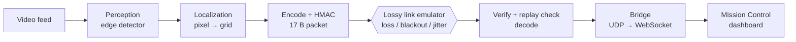

# 🌙 Project C.R.A.T.E.R
**Constrained Reconnaissance, Autonomy & Telemetry in Extreme Regions**
A fully software-emulated pipeline for a lunar rover scout operating inside a permanently shadowed crater:
**no GPS, no cloud, and a degraded radio link.**
`Python 3.10+` · `OpenCV` · `UDP` · `HMAC-SHA256` · `WebSocket` · `HTML/JS`

## Table of contents

1. [Overview](#1-overview)
2. [Key features](#2-key-features)
3. [System architecture](#3-system-architecture)
4. [Design rationale](#4-design-rationale)
5. [Perception: real-time edge detection](#5-perception-real-time-edge-detection)
6. [Localization: pixel to grid coordinates](#6-localization-pixel-to-grid-coordinates)
7. [Telemetry protocol](#7-telemetry-protocol)
8. [Packet security](#8-packet-security)
9. [Resilient transport and link emulation](#9-resilient-transport-and-link-emulation)
10. [Mission Control dashboard](#10-mission-control-dashboard)
11. [Space flight-software compliance](#11-space-flight-software-compliance)
12. [Installation](#12-installation)
13. [Usage](#13-usage)
14. [Testing and benchmarks](#14-testing-and-benchmarks)
15. [Repository structure](#15-repository-structure)
16. [Mapping to the judging rubric](#16-mapping-to-the-judging-rubric)
17. [Limitations and future work](#17-limitations-and-future-work)

---

## 1. Overview

Small autonomous rovers sent to map permanently shadowed lunar craters cannot rely on Earth infrastructure.
Inside a crater, regolith absorbs high-frequency radio signals, so when a rover finds a hazard or an ice deposit
during a blackout, it cannot stream heavy data back to base.

C.R.A.T.E.R. addresses this with four stages, all running locally and without external services:

| Stage | Goal |
|---|---|
| **Perceive** | Detect hazards and key features in the visual feed on the edge device |
| **Localize** | Convert 2D detections into grid coordinates relative to the landing site |
| **Transmit** | Compress each detection into a tiny authenticated packet and send it over a lossy link |
| **Visualize** | Show incoming data on a Mission Control dashboard with explicit data age and uncertainty |

## 2. Key features

- **Real-time edge detection:** classical CV detector, no GPU, no cloud. A latest-frame-wins grabber keeps latency bounded, and live metrics report FPS, latency, CPU and RAM.
- **Defensible pixel-to-3D math:** pinhole camera model with explicit assumptions and a documented error budget.
- **17-byte telemetry packets:** fixed-size binary struct, coordinates quantized to 10 cm.
- **Packet security:** truncated HMAC-SHA256 authentication, constant-time verification, and a sliding replay window that tolerates loss, reordering, and sequence wraparound.
- **Loss tolerance:** sequence-based loss tracking and redundancy of recent detections, validated against an emulator with random loss, burst blackouts, jitter, duplication, and reordering.
- **Mission Control dashboard:** live map, age-based fading, growing uncertainty circles, link status, and security counters.
- **One-command, automated flow** from video ingestion to dashboard.

## 3. System architecture



Rover side: `Perception → Localization → Encode`. Ground side: `Decode → Bridge → Dashboard`.
The two sides communicate only through the emulated link.

## 4. Design rationale

Every component is justified by a mission constraint.

| Constraint | Decision | Justification |
|---|---|---|
| No cloud APIs | Local classical-CV detector | No external dependency, deterministic, CPU-only |
| Severe bandwidth limits | 17-byte binary struct, 10 cm quantization | Much smaller than the equivalent JSON (measured in §14) |
| Lossy radio, blackouts | UDP with sequence numbers and redundancy | A retransmit handshake fails when the link is down for seconds; redundancy recovers data without round trips |
| Untrusted shared link | HMAC authentication and replay window | The ground station must not trust forged, altered, or replayed telemetry |
| Operator trust | Data-age coloring and uncertainty circles | Stale hazards must look stale |
| Flight-software principles | Fixed-size messages, bounded memory, graceful degradation | See §11 |

## 5. Perception: real-time edge detection

**Module:** `perception/realtime.py`

**Detector.** Downscale 2× → grayscale → Gaussian blur → adaptive threshold → contour extraction → area filter.
Dark blobs are classified as rocks/hazards (`class_id = 1`), bright blobs as ice candidates (`class_id = 2`).
Classical CV was chosen over a neural network because it needs no GPU and no weight files, is deterministic,
and runs well above real time on a CPU-only edge computer.

**Real-time behaviour.** A dedicated grabber thread keeps only the newest frame (queue of size 1). If the
detector is slower than the camera, stale frames are dropped instead of queued, so capture-to-detection latency
stays bounded. Video files are paced at their native FPS to emulate a live camera.

**Ground contact point.** Each detection reports the bottom-center of its bounding box, since the ground-plane
projection requires a point that actually touches the ground.

**Per-frame metrics:** FPS, capture-to-detection latency (ms), CPU %, RSS memory (MB).

```python
from perception.realtime import run

def on_detections(dets, t_capture, metrics):
    # dets    : [{"class_id", "pixel_x", "pixel_y", "confidence"}, ...]
    # metrics : {"fps", "latency_ms", "cpu_pct", "rss_mb"}
    ...

run("data/crater.mp4", on_detections)
```

## 6. Localization: pixel to grid coordinates

**Module:** `localization/`

**Model.** Pinhole camera at height `h` above flat ground, pitched down by `θ`, with focal length `f` (pixels)
and principal point `(cx, cy)`.

For a pixel `(u, v)`:

```
a = (u − cx) / f          b = (v − cy) / f

denominator   d = sin θ + b·cos θ          (must be > 0, otherwise the ray misses the ground)
ray scale     t = h / d

right   = a · t
forward = (cos θ − b·sin θ) · t
```

The rover-frame point `(right, forward)` is then rotated by the rover heading `ψ` and translated by the rover
position `(x_r, y_r)` (dead-reckoned from the landing site, since there is no GPS):

```
X = x_r + forward·sin ψ + right·cos ψ
Y = y_r + forward·cos ψ − right·sin ψ
```

Results are quantized to decimeters before transmission (signed 16-bit, range ±3.2 km).

**Assumptions:** flat terrain, known camera height and tilt, calibrated intrinsics, known rover pose.

**Error sources (and why they matter):**

| Source | Effect |
|---|---|
| Tilt error | Range error grows rapidly with distance (roughly quadratic) |
| Non-flat terrain | Systematic bias; far detections are least reliable |
| Dead-reckoning drift | Accumulating offset relative to the landing site |
| Lens distortion | Edge-of-frame bias if not corrected |
| Pixel quantization | Coarser range resolution near the horizon |

This is why the dashboard grows an uncertainty radius with both age and distance.

## 7. Telemetry protocol

**Module:** `telemetry/security.py` (wire format), `telemetry/codec.py`

Fixed-size, big-endian, **17 bytes** per detection:

| Field | Bytes | Description |
|---|---|---|
| `ver` | 1 | Protocol version |
| `seq` | 2 | 16-bit sequence number (wrap-safe) |
| `ts` | 4 | Detection timestamp, drives data aging |
| `class_id` | 1 | Hazard class |
| `x` | 2 | Signed, decimeters from the landing site |
| `y` | 2 | Signed, decimeters from the landing site |
| `conf` | 1 | Confidence, 0 to 255 |
| `tag` | 4 | Truncated HMAC-SHA256 over the preceding 13 bytes |

Fixed-size packets mean no variable-length parsing, no allocation on the hot path, and trivial validation
(wrong length → drop).

## 8. Packet security

**Module:** `telemetry/security.py`

**Threat model.** The radio link is shared and untrusted. Without protection, an attacker could inject fake
hazards, alter coordinates, or replay old packets so stale data appears fresh.

| Threat | Defense |
|---|---|
| Corruption | The authentication tag also detects bit errors |
| Forgery / tampering | HMAC-SHA256 with a pre-shared key; tag compared in constant time |
| Replay / duplicates | 64-packet sliding window over sequence numbers, updated only after authentication succeeds |
| Reordering | Older but unseen packets are accepted; seen or too-old packets are rejected |
| Version mismatch | Unknown `ver` is rejected |

**Design choices**

- **4-byte tag instead of 32:** a forgery needs about 2³² attempts, and each attempt costs a live transmission on a low-rate link. This costs 4 bytes per packet instead of 32.
- **Authentication, not encryption:** hazard positions are not secret on a scouting mission. Integrity and authenticity are what matter, and encryption would add overhead. ChaCha20-Poly1305 is the natural upgrade if confidentiality is required.
- **Window updated after verification:** unauthenticated packets cannot poison replay state.
- **Key handling:** the pre-shared key is read from the `CRATER_KEY` environment variable and is never committed.

```python
import os
from telemetry.security import encode, decode, ReplayWindow

key = bytes.fromhex(os.environ["CRATER_KEY"])

# Rover
packet = encode(key, seq, timestamp, class_id, x_dm, y_dm, conf)   # 17 bytes

# Ground station (one ReplayWindow per rover)
window = ReplayWindow()
fields, reason = decode(key, packet, window)
if fields is None:
    rejected[reason] += 1    # bad_length | bad_tag | bad_version | replay
```

## 9. Resilient transport and link emulation

**Transport.** UDP from rover to ground station, then WebSocket from the bridge to the browser.

**Resilience mechanisms**

- Sequence numbers let the receiver count packets received and lost.
- Redundancy: each transmission repeats the last N detections, so a single dropped packet loses nothing and short blackouts are recovered when the link returns.
- The ground-station hazard map de-duplicates repeated detections.

**Link emulator** (`telemetry/link.py`, `telemetry/channel.py`): random packet loss, burst blackouts of N seconds,
delay and jitter, duplication, and reordering. The emulator is seeded so results are reproducible.

## 10. Mission Control dashboard

**Folder:** `dashboard/`

- 2D top-down map with the landing-site origin, hazards, and rover path
- **Data aging:** markers fade from fresh to stale; each shows "last update Xs ago"
- **Uncertainty:** a circle around each hazard that grows with age
- **Link status:** packets received and lost, with a blackout indicator
- **Security panel:** counters for rejected packets (`bad_tag`, `replay`), as visible proof the defenses work
- Driven by the live pipeline through the UDP → WebSocket bridge

## 11. Space flight-software compliance

| Principle | Implementation |
|---|---|
| Deterministic behavior | Seeded link emulator, no hidden randomness in the pipeline |
| Bounded resources | Size-1 frame queue, fixed 64-bit replay window, fixed-size packets |
| Fail-safe handling of bad input | Invalid, forged, or replayed packets are dropped and counted, never crash the receiver |
| Graceful degradation | During blackouts the dashboard keeps the last known state, flagged as stale |
| No external dependencies at runtime | No cloud, no remote services; only the emulated link |
| Integrity checking | Every packet authenticated |

## 12. Installation

```bash
git clone <repository-url>
cd <repository-name>
python -m venv .venv && source .venv/bin/activate
pip install -r requirements.txt        # opencv-python, numpy, psutil, websockets
```

Generate a shared key (both sides must use the same one):

```bash
export CRATER_KEY=$(python -c "import os; print(os.urandom(16).hex())")
```

## 13. Usage

Full pipeline (video → detection → packets → lossy link → dashboard):

```bash
make demo
# then open http://localhost:8000
```

Custom scenario:

```bash
python -m telemetry.sim_demo --video data/crater.mp4 --loss 0.2 --blackout 5
```

## 14. Testing and benchmarks

```bash
make test      # unit tests: codec, security, replay window, link emulator
make bench     # FPS/CPU/RAM, bytes per detection, delivery rate vs loss
```

Outputs are saved to `tests/outputs/`.

**Security tests** (`tests/test_security.py`): valid packet accepted; duplicate rejected as `replay`; a single flipped
bit rejected as `bad_tag`; wrong key rejected as `bad_tag`; sequence `65534, 65535, 0, 2, 1` (wraparound and
reordering) accepted exactly once each.

**Results** (fill from `tests/outputs/`):

| Metric | Result |
|---|---|
| Detection FPS (CPU only) | |
| Capture-to-detection latency | |
| CPU % / RAM | |
| Bytes per detection (binary vs JSON) | 17 B vs |
| Delivery rate, 20% random loss | |
| Delivery rate, 5 s blackout | |
| Delivery rate, 40% loss + jitter | |
| Forged / tampered / replayed packets accepted | 0 |

## 15. Repository structure

```
perception/      realtime detector, frame grabber, metrics
localization/    pixel → ground-plane → grid transform
telemetry/       codec, security (HMAC + replay), link, channel, sender, receiver,
                 resilient, hazardmap, udp, bridge, compare, sim_demo
dashboard/       Mission Control (HTML/JS, WebSocket client)
tests/           automated tests and benchmark outputs
data/            sample video
```

## 16. Mapping to the judging rubric

| Category (15% each) | Where it is addressed |
|---|---|
| Edge perception efficiency | §5, live FPS / CPU / RAM metrics, latest-frame-wins design |
| Spatial & kinematic math | §6, explicit equations, assumptions, error budget |
| Telemetry & protocol efficiency | §7–§9, 17 B packets, redundancy, loss benchmarks, JSON comparison |
| Mission Control dashboard | §10, aging, uncertainty, link and security status |
| Systems integration & space compliance | §3, §11, §13, one-command automated flow |

## 17. Limitations and future work

- Flat-ground assumption; an elevation or slope model would reduce range error.
- Pre-shared key without rotation; a real mission needs key management and rotation.
- Classical CV is sensitive to lighting; a quantized lightweight neural detector could raise accuracy at higher CPU cost.
- Delta encoding and adaptive redundancy could further cut bandwidth.
